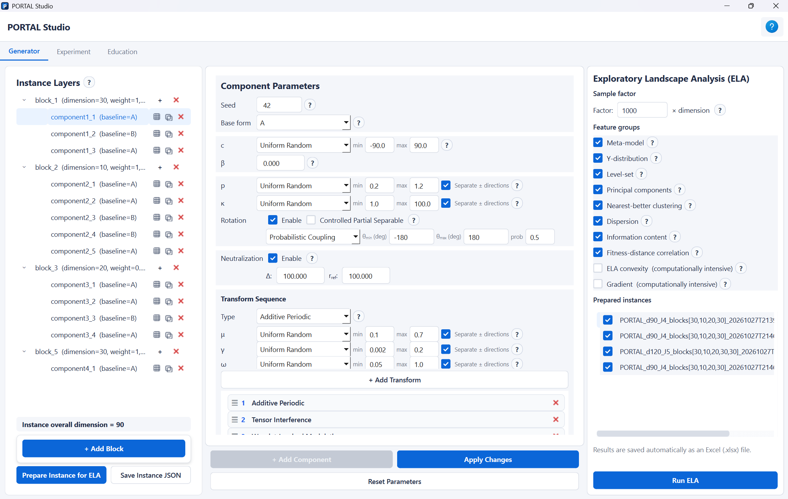
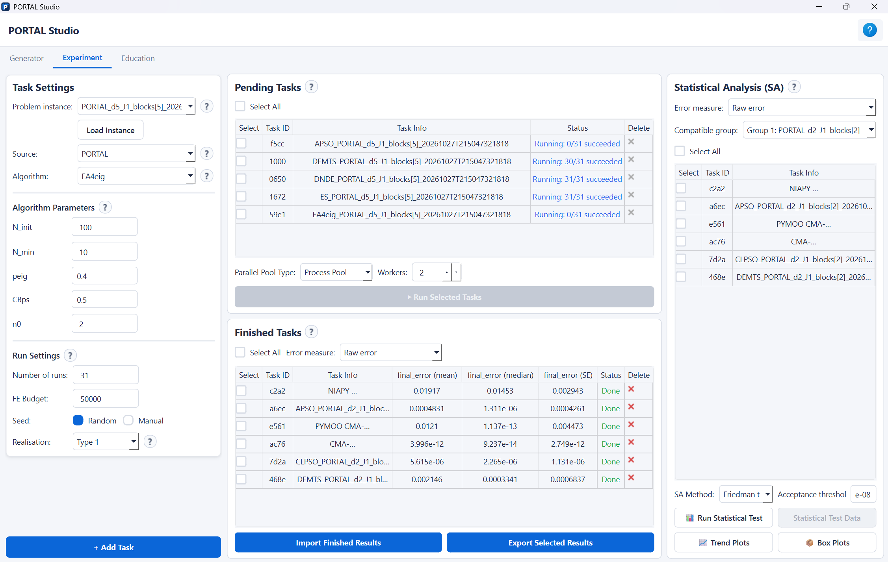
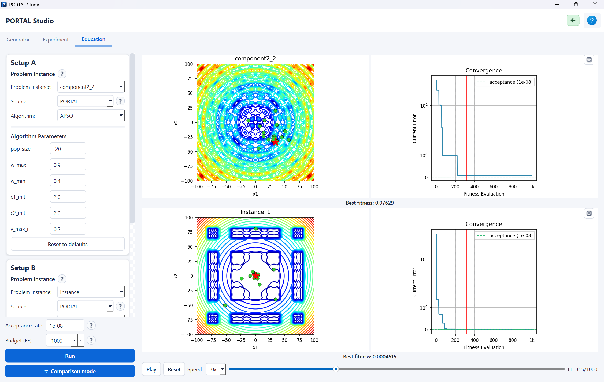

# PORTAL

**Platform for Optimization Research, Testing, Analysis, and Learning**

PORTAL constructs continuous black-box optimization problems from explicit,
reusable recipes. Its controls cover component geometry, conditioning,
variable interactions, transformations, multiple basins, and block-wise
composition. Use **PORTAL Studio** for interactive authoring, experiments,
and education, or use the Python interfaces and configurable runners.

Repository: <https://github.com/EvoMindLab/PORTAL>

Current release: **v2.0.0** (November 3, 2026).

This release is **Python-only**. The previous MATLAB implementation is no
longer maintained; the earlier public version remains in the repository's
history. Persistent single- and multi-block recipes use the same unified
JSON schema.

## Install and launch

Python **3.11 or newer** is required.

```bash
git clone https://github.com/EvoMindLab/PORTAL.git
cd PORTAL
python -m venv .venv
```

Activate the environment in Windows PowerShell:

```powershell
.\.venv\Scripts\Activate.ps1
```

Or on macOS/Linux:

```bash
source .venv/bin/activate
```

Then install and launch from the repository root:

```bash
python -m pip install -r requirements.txt
python -m pip check
python -m portal_studio.gui.app
```

The standard installation includes Studio, ELA, the native algorithm wrappers,
and the PuLP/CBC dependency used for curation. Studio uses **PySide6**, not
PyQt5. No MATLAB or R installation is required. Work from a writable checkout
so that generated instances and run outputs can be saved.

Optional NiaPy and pymoo algorithms:

```bash
python -m pip install -r requirements-algorithms.txt
```

Optional PyTorch acceleration:

```bash
python -m pip install -r requirements-acceleration.txt
```

PyTorch is not needed for the NumPy evaluator. Device-specific PyTorch builds
may require the installation instructions supplied by that project.

## PORTAL Studio

Studio has three workspaces:

- **Generator:** configure blocks, components, and transformations; prepare
  instances; compute ELA features; and save unified JSON files.
- **Experiment:** load prepared or saved instances, configure optimizers and
  repeated runs, inspect progress, and analyze errors and convergence.
- **Education:** author two-dimensional landscapes and replay optimizer
  trajectories on their surface and contour views.







Start with a small FE budget before scheduling a large experiment. Optional
package-backed algorithms require their corresponding package to be installed.
Individual run failures are reported without turning failed runs into valid
measurements.

The [Studio User Manual](Documentation/UserManual.pdf) explains the controls,
file operations, realization modes, and analysis views. Its
[LaTeX source](Documentation/UserManual.tex) is self-contained with respect to
the companion manuscripts; see [documentation build instructions](Documentation/README.md).

## Catalog and ready-to-use suites

| Directory | Recipes | Purpose |
|---|---:|---|
| `Suite/` | 348 | Full 30-dimensional candidate catalog |
| `Benchmark_S50/` | 50 | Curated comparative suite |
| `Benchmark_S20/` | 20 | Balanced suite, five recipes per structural family |
| `Benchmark_Train30/` | 30 | Training collection |
| `Benchmark_Test30/` | 30 | Disjoint test collection |
| `Instances/` | 4 | Ready-to-load example files |

The full catalog contains 35 untransformed single-component recipes, 103
transformed single-component recipes, 112 multi-component recipes, and 98
multi-block recipes. The suite JSONs are unchanged copies of catalog members.
Training and test membership is disjoint; different named suites may overlap.

The identifier-only [membership manifests](manifests/README.md) identify the
catalog, the 241-recipe retained pool, and the selected collections. They do
not contain ELA measurements, optimizer results, or distance statistics.

**Distribution scope:** this repository supplies reusable software and recipe
definitions. It does not distribute the papers' raw ELA/optimizer datasets,
per-run results, experimental realizations, or private analysis artifacts.
The runners compute new measurements locally when requested.

## Generate and evaluate a recipe in Python

```python
from portal_core.benchmark_generator import benchmark_generator
from portal_core.save_instance import save_instance
from portal_problem import PortalProblem

instance = benchmark_generator(
    Seed=42, Dimension=2, NumComponents=1,
    BaselineMode=3, BaselineType="A", TransformMode=3,
)
# Category membership is declared by the user, not inferred from folders.
instance["_suite"] = {"family": "Family1", "recipe_id": "my_recipe"}
path = save_instance(instance, filename="my_recipe.json", output_dir="my_recipes")

problem = PortalProblem(path, max_fe=100, evaluation_device="numpy")
while not problem.is_done():
    problem.evaluate(problem.random_solution())
print(problem.best_f, problem.fe_count)
```

Every curation input needs a unique recipe identifier and category metadata.
Custom categories can be recorded before saving, for example:

```python
instance["_suite"] = {"family": "MyCategory", "recipe_id": "my_recipe"}
```

Declare the same category names in the runner configuration. A directory may
be flat or nested: folder names do not determine category membership.
Studio exports evaluable instances, but a new custom catalog still needs these
user-declared category labels before curation.

## Construct a benchmark suite

Here, **algorithm performance** (or **optimizer behavior**) means the vectors
of checkpoint errors measured with a fixed optimizer portfolio. The code uses
`performance` for this representation and its processing stage.
New configurations use `[performance]` and `selection.performance_weight`.
Legacy ISA-named configuration keys, CLI flags, and measurement filenames are
accepted only as compatibility inputs; existing datasets are not renamed.

The complete runner performs validation, ELA and algorithm-performance
measurement, feature cleaning/selection and scaling, global de-duplication,
fixed-size selection, and JSON materialization. Optional disjoint train/test
selection is configured independently for the two sides.

First try the bounded demonstration:

```bash
python run_suite_pipeline.py --config examples/suite_smoke.toml --dry-run
python run_suite_pipeline.py --config examples/suite_smoke.toml
```

The demonstration uses eight 2D recipes, reduced measurements, and two worker
processes. Its outputs illustrate execution only; they are not replacements
for the released scientific suites.

For the full catalog, copy `suite_pipeline.example.toml`, edit the copy, and
inspect the plan before running:

```bash
python run_suite_pipeline.py --config suite_pipeline.example.toml --dry-run
```

**The full example is a substantial computation:** its default behavioral
measurement schedules 26,796 optimizer runs, plus ELA extraction. Adjust
budgets, repeat counts, checkpoints, worker counts, suite size, and category
bounds to your needs. Do not use it as an installation test.

See the [complete suite-runner configuration reference](Recipe_Selection/suite_pipeline/README.md)
for stage controls, progress reporting, parallel execution, and resume behavior.
PuLP must have an available CBC backend. Some low-level stage scripts require
explicit input paths; the root runner supplies these automatically.

## Generate a larger dataset from a source suite

The augmentation runner creates Type 3 JSON instances from selected source
recipes. It does **not** run ELA, optimizers, de-duplication, or another selection.

```bash
python run_augmentation_dataset.py --config examples/augmentation_smoke.toml --dry-run
python run_augmentation_dataset.py --config examples/augmentation_smoke.toml
```

The small example generates one instance from each of four source recipes.
For a larger dataset, copy `augmentation_dataset.example.toml` and edit the
source bank, sample count, generation ranges, worker controls, and output path.
Its full example requests 5,000 JSONs and up to 95% of available CPU cores.

See the [augmentation reference](Recipe_Selection/augmentation_pipeline/README.md)
for all controls, the block-local exposure safeguard, and resumable execution.

## Add an optimizer

Create a wrapper in `algorithms/` that inherits from `BaseAlgorithm`, implements
`run(problem)`, evaluates through `problem.evaluate` or `evaluate_batch`, and
returns `self._make_result(problem)`. Restart Studio to discover it. See the
manual and `algorithms/DE.py`, `PSO.py`, and `PatternSearch.py` for examples.

## Check the installation

```bash
python -m pip install -r requirements-dev.txt
python -m pytest tests -q
```

The distributed tests use only the public code and recipes. Tests requiring
NiaPy are skipped when it is not installed. The small runner configurations
above exercise process-based curation and augmentation separately.

### Tested environment

The November 3, 2026 release check used Windows x64, Python 3.14.5, PySide6
6.10.1, and the NumPy evaluator. All 254 distributed tests passed with the
optional NiaPy 2.7.1 and pymoo 0.6.2 packages installed; the small curation
and augmentation examples also completed, including resume checks.
This check did not cover GPU execution or macOS/Linux.

## Citation and licensing

The public reference currently available for PORTAL is the
[Part I preprint](https://arxiv.org/abs/2512.00288). Its bibliographic entry is
provided in [Documentation/manual_references.bib](Documentation/manual_references.bib).
Software citation metadata is in [CITATION.cff](CITATION.cff).

PORTAL-owned framework code is distributed under the [MIT license](LICENSE).
This grant does **not** relicense the bundled optimizer implementations or
other third-party software. See [licensing scope](LICENSING.md),
[optimizer licensing](algorithms/README.md), and
[third-party notices](THIRD_PARTY_NOTICES.md) for their separate terms.
The adapted `pflacco` routines retain their original MIT notice in
`pflacco/LICENSE`.

The [provenance notes](algorithms/PROVENANCE.md) and
[license inventory](algorithms/license_inventory.json) document source credits,
preserved upstream terms, and maintainer-confirmed paper implementations.
The author-derived dd-CMA-ES module is excluded from the public release because
no explicit source-code license was found. The exclusion does not affect the
reported experiments or the algorithms available in Studio.

Copyright (c) 2025-present Danial Yazdani, Mai Peng, Delaram Yazdani,
and PORTAL contributors.

Questions: [Danial Yazdani](mailto:danial.yazdani@gmail.com).
